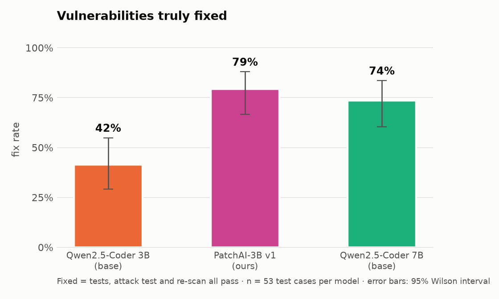
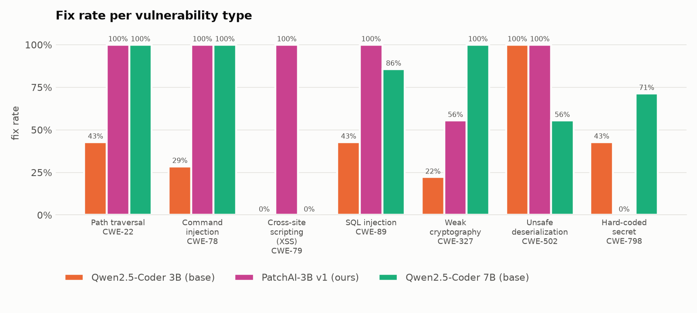
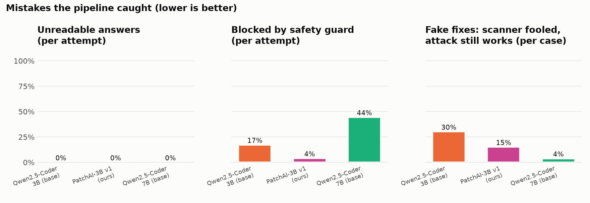
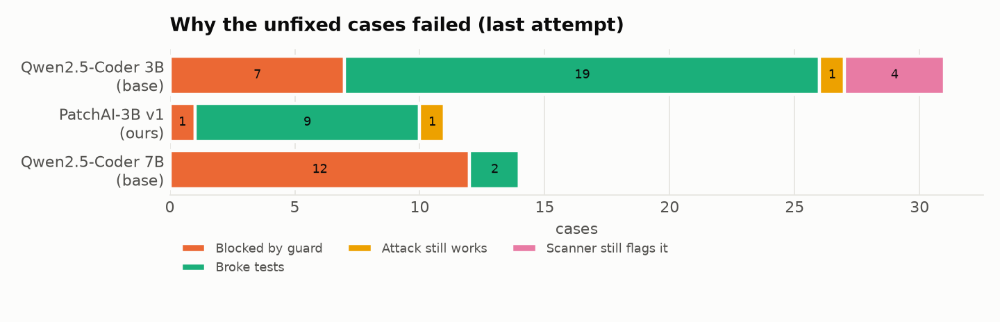

# Evaluation results

Run `v1`, 159 runs.

| Model | Fix rate | 95% interval | Demo shop | First try | Fake fixes | Unreadable | Guard blocked | Avg attempts | Avg time |
| --- | --- | --- | --- | --- | --- | --- | --- | --- | --- |
| Qwen2.5-Coder 3B (base) | **42%** (22/53) | 29%–55% | 1/7 | 30% | 30% | 0% | 17% | 2.3 | 10s |
| PatchAI-3B v1 (ours) | **79%** (42/53) | 67%–88% | 6/7 | 77% | 15% | 0% | 4% | 1.4 | 7s |
| Qwen2.5-Coder 7B (base) | **74%** (39/53) | 60%–84% | 5/7 | 74% | 4% | 0% | 44% | 1.5 | 15s |

## Fix rate per vulnerability type

| Type | Qwen2.5-Coder 3B (base) | PatchAI-3B v1 (ours) | Qwen2.5-Coder 7B (base) |
| --- | --- | --- | --- |
| CWE-22 Path traversal | 43% | 100% | 100% |
| CWE-327 Weak cryptography | 22% | 56% | 100% |
| CWE-502 Unsafe deserialization | 100% | 100% | 56% |
| CWE-78 Command injection | 29% | 100% | 100% |
| CWE-79 Cross-site scripting (XSS) | 0% | 100% | 0% |
| CWE-798 Hard-coded secret | 43% | 0% | 71% |
| CWE-89 SQL injection | 43% | 100% | 86% |

