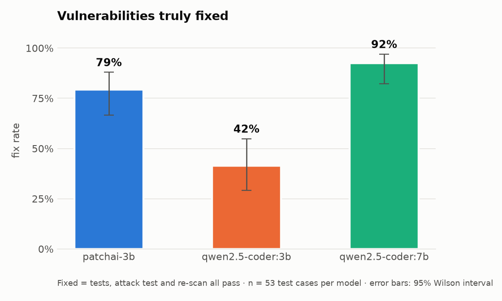
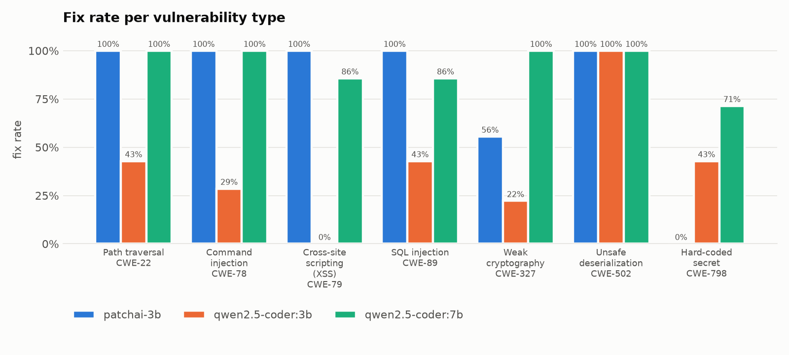
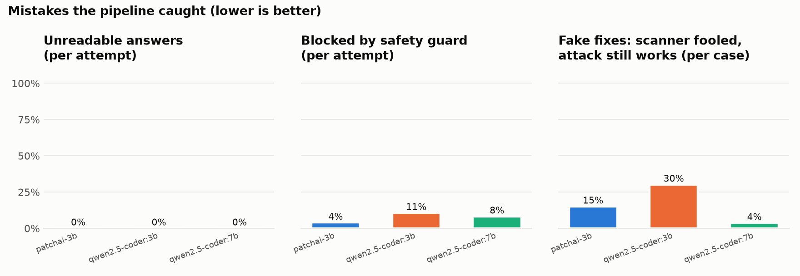
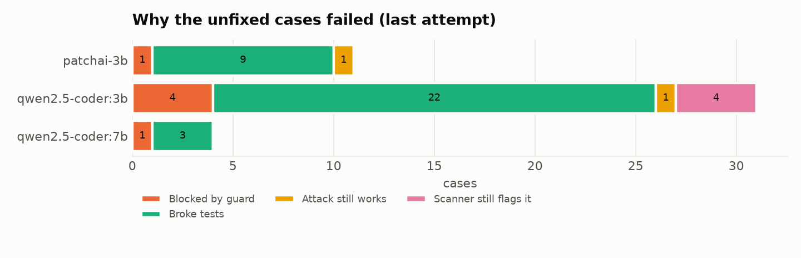

# Evaluation results

Run `v1_rescored`, 159 runs.

| Model | Fix rate | 95% interval | Demo shop | First try | Fake fixes | Unreadable | Guard blocked | Avg attempts | Avg time |
| --- | --- | --- | --- | --- | --- | --- | --- | --- | --- |
| patchai-3b | **79%** (42/53) | 67%–88% | 6/7 | 77% | 15% | 0% | 4% | 1.4 | 7s |
| qwen2.5-coder:3b | **42%** (22/53) | 29%–55% | 1/7 | 30% | 30% | 0% | 11% | 2.3 | 10s |
| qwen2.5-coder:7b | **92%** (49/53) | 82%–97% | 5/7 | 92% | 4% | 0% | 8% | 1.2 | 15s |

## Fix rate per vulnerability type

| Type | patchai-3b | qwen2.5-coder:3b | qwen2.5-coder:7b |
| --- | --- | --- | --- |
| CWE-22 Path traversal | 100% | 43% | 100% |
| CWE-327 Weak cryptography | 56% | 22% | 100% |
| CWE-502 Unsafe deserialization | 100% | 100% | 100% |
| CWE-78 Command injection | 100% | 29% | 100% |
| CWE-79 Cross-site scripting (XSS) | 100% | 0% | 86% |
| CWE-798 Hard-coded secret | 0% | 43% | 71% |
| CWE-89 SQL injection | 100% | 43% | 86% |

