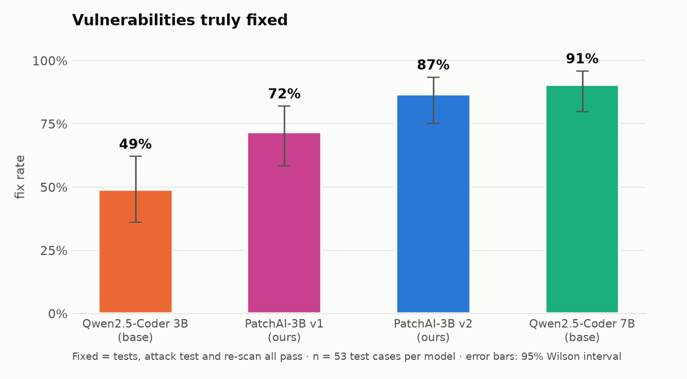
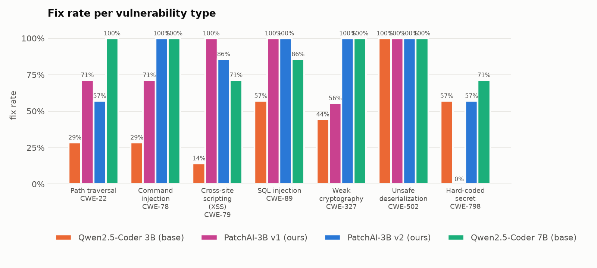
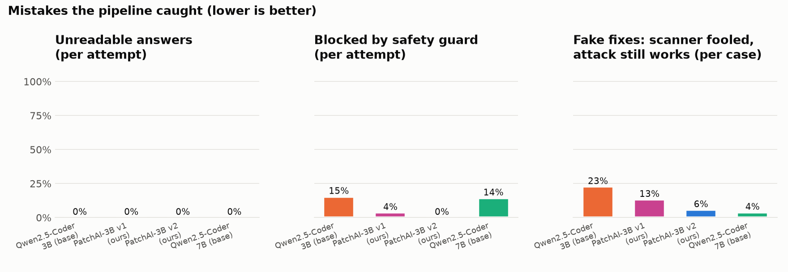
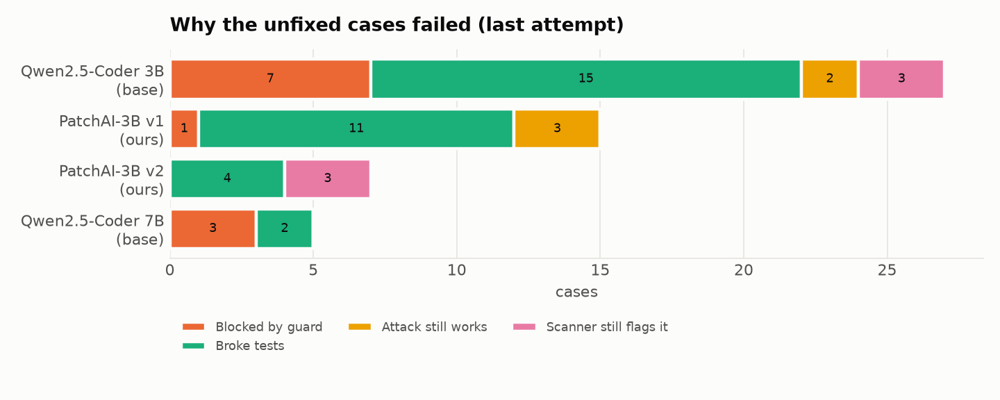

# Evaluation results

Run `v2`, 212 runs.

| Model | Fix rate | 95% interval | Demo shop | First try | Fake fixes | Unreadable | Guard blocked | Avg attempts | Avg time |
| --- | --- | --- | --- | --- | --- | --- | --- | --- | --- |
| Qwen2.5-Coder 3B (base) | **49%** (26/53) | 36%–62% | 4/7 | 38% | 23% | 0% | 15% | 2.2 | 9s |
| PatchAI-3B v1 (ours) | **72%** (38/53) | 58%–82% | 6/7 | 72% | 13% | 0% | 4% | 1.6 | 7s |
| PatchAI-3B v2 (ours) | **87%** (46/53) | 75%–93% | 6/7 | 87% | 6% | 0% | 0% | 1.3 | 6s |
| Qwen2.5-Coder 7B (base) | **91%** (48/53) | 80%–96% | 5/7 | 91% | 4% | 0% | 14% | 1.2 | 20s |

## Fix rate per vulnerability type

| Type | Qwen2.5-Coder 3B (base) | PatchAI-3B v1 (ours) | PatchAI-3B v2 (ours) | Qwen2.5-Coder 7B (base) |
| --- | --- | --- | --- | --- |
| CWE-22 Path traversal | 29% | 71% | 57% | 100% |
| CWE-327 Weak cryptography | 44% | 56% | 100% | 100% |
| CWE-502 Unsafe deserialization | 100% | 100% | 100% | 100% |
| CWE-78 Command injection | 29% | 71% | 100% | 100% |
| CWE-79 Cross-site scripting (XSS) | 14% | 100% | 86% | 71% |
| CWE-798 Hard-coded secret | 57% | 0% | 57% | 71% |
| CWE-89 SQL injection | 57% | 100% | 100% | 86% |

